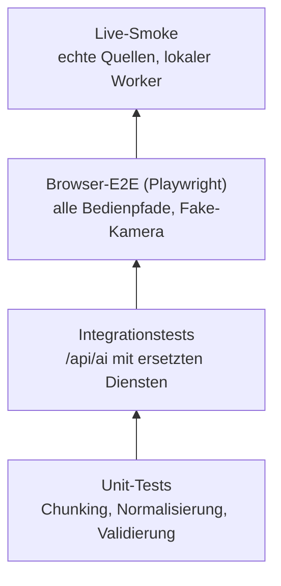
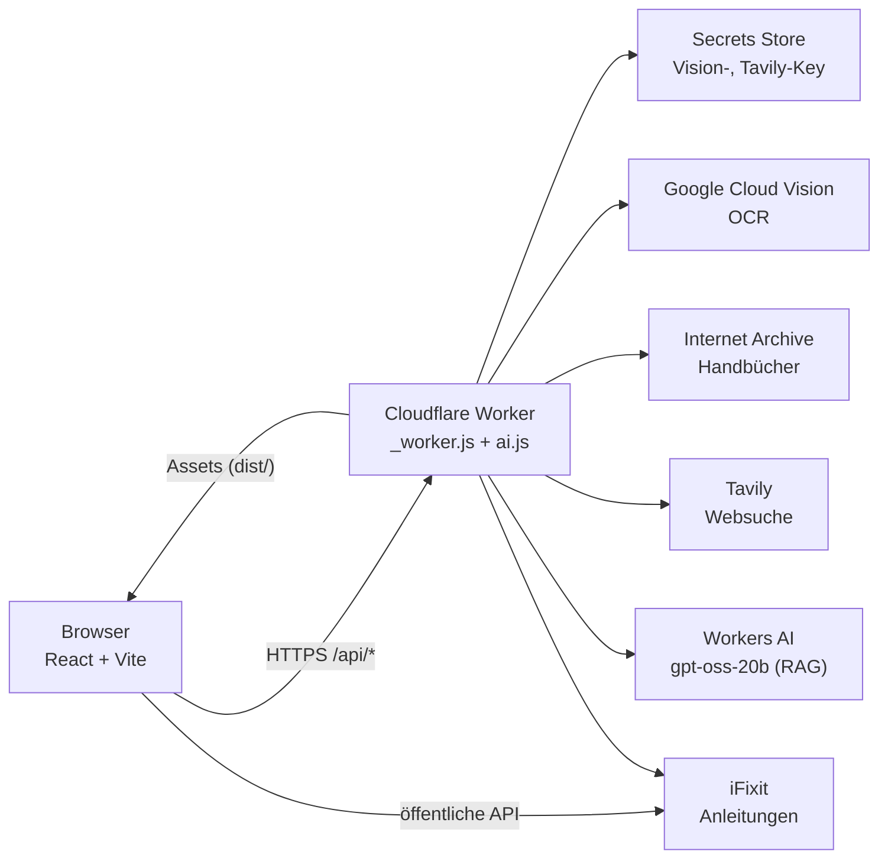
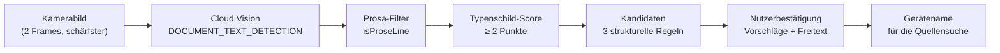
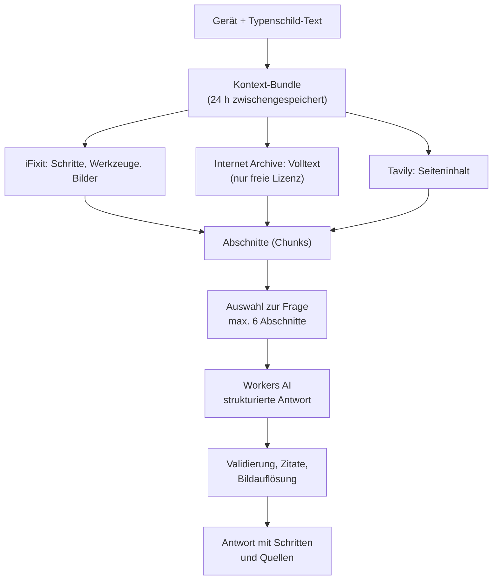
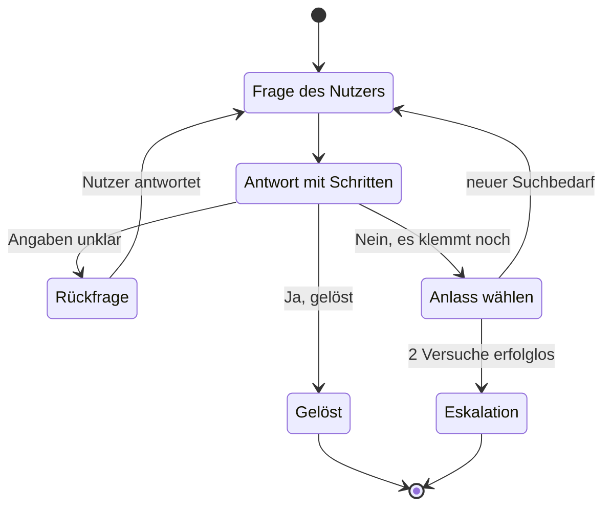

# mendooR — Entwicklung einer mobilen Anwendung zur Identifikation und Reparaturunterstützung von Elektroaltgeräten

**Bachelorarbeit**

> **Arbeitsstand:** 29.10.2026
> **Charakter:** Gemeinsam wachsendes Dokument. Bereits freigegebener Text ([Kapitel 1](#kap-1)–2) wurde unverändert übernommen. Abschnitte ohne Ausgangsmaterial sind als **`[LÜCKE]`** markiert und nicht mit erfundenem Inhalt gefüllt. Noch nicht abgeschlossene Vorgänge sind als **`[OFFEN]`** gekennzeichnet.
> **Konsistenzhinweis:** Zwischen frühem Konzept und späterer technischer Umsetzung bestehen dokumentierte Abweichungen (insb. Web-App statt Android); sie werden transparent ausgewiesen, nicht stillschweigend korrigiert. Die Kapitelnummerierung wurde gegenüber dem ersten Entwurf erweitert (neue [Kapitel 3](#kap-3) „Methodisches Vorgehen" und [Abschnitt 5.2](#kap-5-2) „Gestaltungsgrundlagen").

---

## Inhaltsverzeichnis

- [1. Einleitung](#kap-1)
  - [1.1 Motivation und Problemstellung](#kap-1-1)
  - [1.2 Zielsetzung der Arbeit](#kap-1-2)
  - [1.3 Aufbau der Arbeit](#kap-1-3)
- [2. Theoretische Grundlagen und Stand der Technik](#kap-2)
  - [2.1 Elektroschrott und Kreislaufwirtschaft](#kap-2-1)
  - [2.2 Facilitated Do-It-Yourself Repair (FDR)](#kap-2-2)
  - [2.3 Grundlagen der mobilen Bildverarbeitung und OCR](#kap-2-3) `[LÜCKE]`
  - [2.4 Bestehende Lösungen](#kap-2-4) `[LÜCKE]`
- [3. Methodisches Vorgehen](#kap-3)
  - [3.1 Iteratives, sitzungsbasiertes Vorgehen](#kap-3-1)
  - [3.2 Quellenbasierte Entscheidungsfindung](#kap-3-2)
  - [3.3 Dokumentations- und Fehlererfassungsschema](#kap-3-3)
  - [3.4 Grenzen des Vorgehens](#kap-3-4)
  - [3.5 Verifikation durch automatisierte Tests](#kap-3-5) *(neu)*
- [4. Analyse der Nutzeranforderungen und Szenarien](#kap-4)
  - [4.1 Methodische Vorbemerkung](#kap-4-1)
  - [4.2 Barrieren beim Nutzer](#kap-4-2)
  - [4.3 Anforderungen an die Anwendung](#kap-4-3)
  - [4.4 Nutzungsszenarien](#kap-4-4)
  - [4.5 Offene Anforderung: Kategorien und Datenschutz](#kap-4-5)
  - [4.6 Zusammenfassung des Kapitels](#kap-4-6)
- [5. Konzeption der Anwendung mendooR](#kap-5)
  - [5.1 Systemarchitektur](#kap-5-1)
  - [5.2 Gestaltungsgrundlagen](#kap-5-2)
  - [5.3 Kamerasteuerung als Teil des UI/UX-Konzepts](#kap-5-3)
  - [5.4 Informationsarchitektur](#kap-5-4)
- [6. Entwicklung der Texterkennungs- und Klassifikationspipeline](#kap-6)
  - [6.1 Technologieentscheidung](#kap-6-1)
  - [6.2 Problem listenbasierter Klassifikation](#kap-6-2)
  - [6.3 Strukturbasierte Merkmalserkennung](#kap-6-3)
  - [6.4 Mehrsprachigkeit](#kap-6-4)
  - [6.5 Trefferquote als leitendes Entwurfsprinzip](#kap-6-5)
- [7. Anbindung und Bewertung externer Informationsquellen](#kap-7)
  - [7.1 iFixit](#kap-7-1)
  - [7.2 Reddit: Scheitern der API-Anbindung](#kap-7-2)
  - [7.3 Internet Archive](#kap-7-3)
  - [7.4 Websuche](#kap-7-4)
  - [7.5 KI-gestützte Assistenzschicht](#kap-7-5)
  - [7.6 Fragebezogener Reparaturdialog](#kap-7-6)
- [8. Evaluation](#kap-8) `[LÜCKE]`
- [9. Fazit und Ausblick](#kap-9)
  - [9.1 Zusammenfassung der Ergebnisse](#kap-9-1)
  - [9.2 Limitationen](#kap-9-2)
  - [9.3 Zukünftige Erweiterungen](#kap-9-3)
- [Quellenverzeichnis](#kap-quellenverzeichnis)

### Abbildungsverzeichnis

- [Abbildung 3.1](#abb-3-1): Testpyramide der mendooR-Teststrategie
- [Abbildung 5.1](#abb-5-1): Systemarchitektur (Client, Worker, Dienste)
- [Abbildung 6.1](#abb-6-1): Verarbeitungskette vom Kamerabild zum bestätigten Gerätenamen
- [Abbildung 7.1](#abb-7-1): Aufbau des Kontext-Bundles und fragebezogenes Retrieval
- [Abbildung 7.2](#abb-7-2): Zustände des Reparaturdialogs

> Die Abbildungen sind als Mermaid-Quelle eingebettet (in Markdown- und GitHub-Renderern direkt sichtbar) und für die Abgabe als Grafik zu exportieren.

---

# 1. Einleitung

## 1.1 Motivation und Problemstellung

Die gegenwärtige Lebensweise ist durch eine fortschreitende Technisierung geprägt, die zu einer stetigen Zunahme von Elektroaltgeräten im privaten und beruflichen Umfeld führt [[1]](#ref-1). In privaten Haushalten findet sich oft eine Vielzahl ungenutzter Altgeräte wie Smartphones, Informationstechnik oder Haushaltsgeräte, die entweder ungenutzt gelagert oder unsachgemäß über den Hausmüll entsorgt werden [[1]](#ref-1). Ein markantes Beispiel für diese Entwicklung stellen Einwegprodukte wie elektronische Zigaretten dar, die trotz technischer Funktionalität nach dem Verbrauch der Aromastoffe als Abfall entsorgt werden [[1]](#ref-1). Diese Tendenz gefährdet die globale Bewohnbarkeit und erfordert neue Ansätze zur Wiederverwendung vorhandener Ressourcen [[1]](#ref-1).

Auf globaler Ebene wurde für das Jahr 2022 eine Gesamtmenge von 62 Milliarden Kilogramm Elektroschrott dokumentiert, was einer pro-Kopf-Menge von 7,8 Kilogramm entspricht [[1]](#ref-1). Von dieser massiven Abfallmenge wurden lediglich 22,3 % offiziellen und fachgerechten Recyclingprozessen zugeführt [[1]](#ref-1). Die stoffliche Zusammensetzung dieser Abfälle umfasst primär Metalle mit einem Anteil von 31 Milliarden Kilogramm, gefolgt von Kunststoffen mit 17 Milliarden Kilogramm sowie weiteren Mineralien im Umfang von 14 Milliarden Kilogramm [[1]](#ref-1).

Ökonomisch betrachtet repräsentiert der generierte Elektroschrott einen potenziellen Materialwert von etwa 91 Milliarden US-Dollar, wobei signifikante Anteile auf Kupfer (19 Milliarden USD), Gold (15 Milliarden USD) und Eisen (16 Milliarden USD) entfallen [[1]](#ref-1). Während die theoretischen Kosten für ein umfassendes Recycling auf 37 Milliarden US-Dollar geschätzt werden, führt die unvollständige und unsachgemäße Behandlung zu massiven Umweltbelastungen durch Schadstoffe wie Blei und Quecksilber, deren externe Kosten auf 78 Milliarden US-Dollar beziffert werden [[1]](#ref-1). In der Gesamtbilanz resultiert aus der aktuellen Entsorgungspraxis ein wirtschaftliches Defizit von 37 Milliarden US-Dollar durch Umwelt- und Gesundheitsschäden [[1]](#ref-1). Häufig scheitert die Wiederverwendung funktionsfähiger Komponenten, wie beispielsweise die Nutzung alter Laptops als Homeserver oder Mediathek, an einem hohen Rechercheaufwand für den Endnutzer. Es besteht somit eine Diskrepanz zwischen der ökologischen Notwendigkeit einer Lebensdauerverlängerung und dem individuellen Informationszugang für Reparatur- und DIY-Projekte [[1]](#ref-1).

## 1.2 Zielsetzung der Arbeit

Das Ziel der vorliegenden Bachelorarbeit ist die Entwicklung einer mobilen Applikation zur automatisierten Identifizierung von Elektrogeräten, um die Wiederverwendung und das fachgerechte Recycling gezielt zu fördern [[2]](#ref-2). Durch den verbesserten Zugang zu technischen Informationen soll die technologische Unabhängigkeit der Nutzer gestärkt und ein verantwortungsvoller Umgang mit Endgeräten etabliert werden [[2]](#ref-2). Die Arbeit verfolgt den Ansatz, technisches Know-how so aufzubereiten, dass Anwender in die Lage versetzt werden, technologische Zusammenhänge besser zu verstehen und beispielsweise Komponenten wie Kamerasysteme für neue Einsatzzwecke zu extrahieren [[2]](#ref-2). Hierbei soll das Bewusstsein dafür geschärft werden, dass die Verantwortung für nachhaltiges Handeln nicht ausschließlich bei großen Technologiekonzernen liegt, sondern durch individuelle Kompetenz gefördert werden kann [[2]](#ref-2).

## 1.3 Aufbau der Arbeit

Die Arbeit gliedert sich nach der Einleitung in einen theoretischen Teil, der die Grundlagen von Elektroschrott und das Konzept des Facilitated Do-It-Yourself Repair (FDR) erläutert [[1]](#ref-1). Darauf folgt eine Analyse der Nutzeranforderungen sowie der relevanten Nutzungsszenarien [[2]](#ref-2). Im Anschluss werden die Konzeption und das technische Design der Applikation mendooR detailliert beschrieben, gefolgt von der Dokumentation der Implementierung. Den Abschluss bilden eine systematische Evaluation der Erkennungsraten und der Nutzererfahrung sowie ein zusammenfassendes Fazit mit Ausblick auf zukünftige Entwicklungen [[2]](#ref-2).

> **[Konsistenzhinweis, nicht Teil des freigegebenen Originaltextes]:** Der vorstehende Absatz benannte im ursprünglichen Konzept eine „Dokumentation der Implementierung im Android-Ökosystem". Im tatsächlichen Projektverlauf wurde mendooR als browserbasierte mobile Web-Anwendung realisiert (siehe [Kapitel 5](#kap-5) und 6), nicht als native Android-Anwendung. Diese Abweichung wird hier transparent ausgewiesen. Für die Einreichung ist zu entscheiden, ob [Abschnitt 1.3](#kap-1-3) an die tatsächliche technische Umsetzung angepasst wird.

---

# 2. Theoretische Grundlagen und Stand der Technik

## 2.1 Elektroschrott und Kreislaufwirtschaft

Elektroschrott wird wissenschaftlich in sechs Hauptkategorien unterteilt, um die unterschiedlichen Anforderungen an die Abfallbehandlung abzubilden [[1]](#ref-1). Hierzu zählen Wärmeüberträger wie Kühlsysteme und Wärmepumpen, Bildschirme und Monitore, Lampen sowie Großgeräte wie Waschmaschinen und Photovoltaikanlagen [[1]](#ref-1). Ergänzt wird diese Systematik durch Kleingeräte sowie kleine IT- und Telekommunikationsgeräte [[1]](#ref-1).

Von der Definition als Elektroschrott ausgenommen sind Batterien sowie elektronische Komponenten, die fest in Fahrzeugen verbaut sind, da diese als Teil eines Gesamtsystems fungieren und nicht als eigenständige Elektrogeräte betrachtet werden [[1]](#ref-1). Ebenfalls nicht inkludiert sind militärische Ausrüstungsgüter und Weltraumschrott [[1]](#ref-1). Ein zentrales Problem der Kreislaufwirtschaft stellt der Export von Altgeräten in Regionen ohne ausreichende Recycling-Infrastruktur dar, was die ökologischen Risiken verschärft [[1]](#ref-1). In diesem Kontext gewinnt das Konzept des Urban Mining an Bedeutung, welches die Rückgewinnung wertvoller Sekundärrohstoffe aus anthropogenen Lagern forciert [[1]](#ref-1).

## 2.2 Facilitated Do-It-Yourself Repair (FDR)

Das Konzept des Facilitated Do-It-Yourself Repair (FDR) beschreibt die aktive Unterstützung von Konsumenten bei der Instandsetzung ihrer Geräte durch Bereitstellung spezifischer Ressourcen [[2]](#ref-2). Dieser Ansatz zielt auf eine Verlängerung der Produktlebensdauer ab, indem Hersteller oder Dienstleister den Nutzern notwendige Werkzeuge, Ersatzteile und detaillierte Anleitungen zur Verfügung stellen [[2]](#ref-2). Im Sinne der Kreislaufwirtschaft wird Reparatur hierbei als ein Prozess der gemeinsamen Wertschöpfung verstanden, der die passive Rolle des Konsumenten hin zu einem aktiven Teilnehmer an der Produktlebenszyklus-Erhaltung transformiert [[2]](#ref-2). Die Förderung von FDR-Maßnahmen gilt als wesentliche Strategie zur Reduzierung von Elektroschrott und zur Steigerung der Ressourceneffizienz [[2]](#ref-2).

## 2.3 Grundlagen der mobilen Bildverarbeitung und OCR

> **`[LÜCKE]` — kein Ausgangsmaterial vorhanden.** Dieser Abschnitt soll die allgemeinen technischen Grundlagen der optischen Zeichenerkennung (OCR) auf mobilen Endgeräten unabhängig von der in mendooR konkret gewählten Umsetzung darstellen. Vorhandenes, aber anwendungsspezifisches Material zur tatsächlich eingesetzten Technologie findet sich in [Kapitel 6.1](#kap-6-1); für einen allgemeinen Grundlagenabschnitt ist eigenständige Literaturarbeit erforderlich, etwa zur Funktionsweise klassischer OCR-Pipelines (Segmentierung, Merkmalsextraktion, Klassifikation) im Unterschied zu modernen Cloud-basierten Ansätzen.

## 2.4 Bestehende Lösungen

> **`[LÜCKE]` — kein Ausgangsmaterial vorhanden.** Dieser Abschnitt soll bestehende Plattformen zur Reparaturunterstützung (insbesondere iFixit, das in mendooR als Datenquelle dient) sowie vergleichbare Anwendungen zur Geräteidentifikation analysieren und mendooR davon abgrenzen. Die technische Anbindung von iFixit ist in [Kapitel 7.1](#kap-7-1) beschrieben, ersetzt jedoch keine Marktanalyse bestehender Lösungen.

---

# 3. Methodisches Vorgehen

*Dieses Kapitel wurde nachträglich als eigenständiges Kapitel aufgenommen, um die Vorgehensweise der Arbeit offenzulegen.*

## 3.1 Iteratives, sitzungsbasiertes Vorgehen

Die Entwicklung von mendooR erfolgte iterativ und implementierungsgetrieben. Jede Arbeitssitzung begann mit dem verifizierten Stand der vorangegangenen Sitzung, führte zu einem getesteten Inkrement und endete mit einer dokumentierten Planung der nächsten Schritte. Dieses Vorgehen trägt den externen Unwägbarkeiten Rechnung, die das Projekt prägten: die Abhängigkeit von Drittanbieter-Schnittstellen (siehe [Kapitel 7](#kap-7)) und begrenzte Kontingente kostenpflichtiger Dienste. Ein klassisch lineares Vorgehen hätte auf zwischenzeitliche Änderungen externer Randbedingungen (etwa die Zugriffsbeschränkungen von Reddit) nicht angemessen reagieren können.

## 3.2 Quellenbasierte Entscheidungsfindung

Technische und gestalterische Entscheidungen wurden nicht nach Plausibilität, sondern nach belegbaren Kriterien getroffen. Für Gestaltungsfragen galt eine feste Quellenhierarchie mit den Apple Human Interface Guidelines [[3]](#ref-3) an erster Stelle, gefolgt von den Google *Mobile App UX Principles* [[4]](#ref-4) und der Google *Interactive Canvas*-Gestaltungsrichtlinie. Für technische Fragen wurden Primärquellen (Herstellerdokumentation) und, wo verfügbar, wissenschaftliche Publikationen herangezogen. Jede wesentliche Entscheidung wurde mit Kontext, geprüften Optionen, verworfenen Alternativen und Begründung dokumentiert.

## 3.3 Dokumentations- und Fehlererfassungsschema

Jedes technische Problem wurde nach einem festen Schema erfasst: *Symptom → Diagnose → Ursache → Lösung → Erkenntnis*. Die Erkenntnis wurde bewusst verallgemeinert formuliert, um über den Einzelfall hinaus in die Reflexion ([Kapitel 8](#kap-8)) einzufließen. Der Projektverlauf wurde fortlaufend protokolliert; Entscheidungen wurden zusätzlich thematisch registriert.

## 3.4 Grenzen des Vorgehens

Das implementierungsgetriebene Vorgehen bringt eine methodische Einschränkung mit sich: Es fand **keine vorgelagerte, eigenständige Anforderungsanalyse** statt. Die in [Kapitel 4](#kap-4) zu formulierenden Nutzeranforderungen lassen sich daher nur retrospektiv aus dem entstandenen System ableiten. Diese Einschränkung wird ausdrücklich kenntlich gemacht, um den Anschein einer zum Entwicklungsbeginn durchgeführten Erhebung zu vermeiden.

## 3.5 Verifikation durch automatisierte Tests

Ergänzend zur dokumentierten Fehlererfassung wurde mit der Erweiterung der Assistenzschicht eine automatisierte Testpyramide eingeführt. Sie umfasst vier Ebenen ([Abbildung 3.1](#abb-3-1)): Unit-Tests für reine Logik (Chunking, Textnormalisierung, Datenminimierung, Validierung der Modellantwort, Geräteabgleich), Integrationstests des Worker-Endpunkts mit ersetzten externen Diensten, Browser-End-to-End-Tests für alle Bedienabläufe einschließlich Kamera- und OCR-Pfad sowie einen netzgebundenen Smoke-Test gegen die realen Quellen. Die externen Dienste werden in den Tests durch deterministische Fixtures ersetzt; die Suite läuft dadurch ohne Zugangsschlüssel und unabhängig von der Verfügbarkeit Dritter.

*Abbildung 3.1: Testpyramide der mendooR-Teststrategie (eigene Darstellung nach [[5]](#ref-5)).*

Die End-to-End-Ebene prüft bewusst jede anklickbare Fläche und nicht nur den Idealfall: Erfolgs-, Leer- und Fehlerpfade samt Wiederholungsaktion werden ebenso abgedeckt wie der Kameraausfall. Damit wird die in [Abschnitt 3.3](#kap-3-3) geforderte Ehrlichkeit gegenüber Fehlern technisch abgesichert — ein Rückfall in einen unbehandelten Zustand fällt im Testlauf auf und nicht erst im Nutzerbetrieb. Die Tests belegen die Funktionstreue des Systems, nicht die inhaltliche Qualität der Antworten; diese wird in [Kapitel 8](#kap-8) gemessen. Die Suite umfasst Unit-Tests der reinen Logik, Integrationstests des Worker-Endpunkts und 45 Browser-Tests; ein netzgebundener Smoke-Test prüft das Bundle gegen die realen Quellen.

---

# 4. Analyse der Nutzeranforderungen und Szenarien

## 4.1 Methodische Vorbemerkung

Dieses Kapitel ist **retrospektiv rekonstruiert**. Im Projektverlauf fand keine eigenständige, der Implementierung vorgelagerte Anforderungserhebung statt (Befragung, Interviews, Beobachtungsstudie). Die Anforderungen werden daher aus drei dokumentierten Quellen hergeleitet: aus der Problemstellung und Motivation ([Kapitel 1.1](#kap-1-1)), aus dem Konzept des Facilitated Do-It-Yourself Repair ([Kapitel 2.2](#kap-2-2)) sowie aus den während der Entwicklung und Nutzung protokollierten Beobachtungen.

Diese Offenlegung ist notwendig, um den Anschein einer vorgelagerten Erhebung zu vermeiden. Die rekonstruierten Anforderungen sind als Arbeitsgrundlage belastbar, weil jede auf eine konkrete Beobachtung oder ein belegtes Problem zurückführbar ist; sie ersetzen jedoch **keine** empirische Nutzerstudie. Eine solche bleibt als Erweiterung offen ([Kapitel 8](#kap-8)).

## 4.2 Barrieren beim Nutzer

Aus der Problemstellung ([Kapitel 1.1](#kap-1-1)) und dem FDR-Konzept ([Kapitel 2.2](#kap-2-2)) lassen sich Barrieren identifizieren, die einer Reparatur oder Wiederverwendung entgegenstehen:

- **Hoher Rechercheaufwand.** Passende Informationen zum konkreten Gerät sind über viele Quellen verstreut und müssen mühsam zusammengetragen werden. Dies ist die in [Kapitel 1.1](#kap-1-1) benannte zentrale Diskrepanz zwischen ökologischer Notwendigkeit und individuellem Informationszugang [[1]](#ref-1).
- **Fehlende Zuordnung Gerät → Anleitung.** Dem Nutzer fehlt häufig die konkrete Modellbezeichnung, die für eine gezielte Suche erforderlich ist.
- **Fragmentierte Quellen.** Kuratierte Anleitungen, Erfahrungsberichte aus Foren, Videoanleitungen und archivierte Dokumente liegen in getrennten Systemen mit unterschiedlicher Struktur und Verlässlichkeit vor.
- **Fehlende Dokumentation für Alt- und Nischengeräte.** Für ältere oder wenig verbreitete Geräte existieren oft nur gescannte Handbücher oder keine zugängliche Dokumentation [[2]](#ref-2).
- **Fehlendes Wissen über Wiederverwendung.** Statt einer Zweitnutzung (etwa Laptop als Homeserver) erfolgt häufig die Entsorgung [[1]](#ref-1).

## 4.3 Anforderungen an die Anwendung

Die Anforderungen gliedern sich in funktionale (FA) und nicht-funktionale (NFA) Anforderungen. Jede ist auf ihre Herleitung und das behandelnde Kapitel zurückgeführt.

### Funktionale Anforderungen

| ID | Anforderung | Hergeleitet aus | Umsetzung (Kapitel) |
|---|---|---|---|
| FA-01 | Ein Gerät soll anhand eines Fotos seines Typenschilds automatisiert identifiziert werden. | Kap. 1.1; Bedarf nach Zuordnung Gerät → Anleitung | [5.1](#kap-5-1), [6](#kap-6) |
| FA-02 | Die Identifikation muss unempfindlich gegen irrelevanten Umgebungstext sein (Verpackung, Anleitung, Untergrund). | Beobachtung: Bodenscan lieferte scheinbar „Text“ | [6.2](#kap-6-2) |
| FA-03 | Typenschilder in beliebigen Beschriftungssprachen müssen verarbeitet werden können. | Anspruch weltweiter Nutzbarkeit; chinesisch beschriftetes Gerät | [6.1](#kap-6-1), [6.4](#kap-6-4) |
| FA-04 | Passende Reparaturanleitungen sollen angezeigt werden (Deutsch bevorzugt, Englisch als Fallback). | Kap. 1.1, 2.2 | [7.1](#kap-7-1) |
| FA-05 | Erfahrungswissen aus Community und Foren soll zugänglich gemacht werden. | Kap. 1.1 | [7.2](#kap-7-2) |
| FA-06 | Dokumentation für alte oder obsolete Geräte soll auffindbar sein. | Kap. 1.1 | [7.3](#kap-7-3) |
| FA-07 | Als weitere Quelle sollen Fachartikel über eine Websuche erschlossen werden. | Rückmeldung aus der realen Nutzung | [7.4](#kap-7-4) |
| FA-08 | Wege zur Entsorgung und zur Weiterverwendung sollen aufgezeigt werden. | Kap. 1.1, 2.1 | offen ([9.3](#kap-9-3)) |
| FA-09 | Zuletzt gescannte Geräte sollen zugänglich sein. | UI-Konzept | offen: Persistenz ([9.3](#kap-9-3)) |
| FA-10 | Geräte sollen über die sechs Elektroaltgeräte-Kategorien strukturiert werden. | Kap. 2.1 | offen ([4.5](#kap-4-5)) |
| FA-11 | Eine konkrete Reparaturfrage soll in einem Dialog beantwortet werden — nicht nur mit einer allgemeinen Zusammenfassung. | Nutzerbeobachtung: Fragen wie „Teile sind oxidiert“ blieben unbeantwortet | [7.6](#kap-7-6) |
| FA-12 | Jede Antwort muss ihre Aussagen mit Quellen belegen und Arbeitsschritte als nachvollziehbare Sequenz liefern. | Kap. 1.1 (Rechercheaufwand), 2.2 | [7.5](#kap-7-5), [7.6](#kap-7-6) |
| FA-13 | Zu Arbeitsschritten sollen passende Bilder aus der jeweiligen Quelle angezeigt werden. | Praktischer Reparaturbedarf; Vergleich mit bestehenden Anleitungen | [7.6](#kap-7-6) |

### Nicht-funktionale Anforderungen

| ID | Anforderung | Hergeleitet aus | Umsetzung (Kapitel) |
|---|---|---|---|
| NFA-01 | Geräteunabhängige Nutzbarkeit (kein App-Store, keine Plattformbindung). | Geräteunabhängigkeit als Zielsetzung | [5.1](#kap-5-1) |
| NFA-02 | API-Schlüssel dürfen niemals im Client erscheinen. | Sicherheitsüberlegung zum Schlüsselumgang | [5.1](#kap-5-1) |
| NFA-03 | Die Bedienung folgt anerkannten Mobile-Guidelines. | Anforderungen mobiler Bedienung | [5.2](#kap-5-2), [5.4](#kap-5-4) |
| NFA-04 | Die Darstellung muss auf allen Bildschirmgrößen ohne horizontalen Überlauf funktionieren. | Anspruch mobiltauglicher Darstellung | [5.3](#kap-5-3) |
| NFA-05 | Das Erkennungsergebnis muss trotz verbleibender Unsicherheit nutzbar sein (Vorschläge + Bestätigung). | Analyse der Extraktionsgrenzen | [6.5](#kap-6-5) |
| NFA-06 | Zwischen Auslöser und Ergebnis soll nur geringe Latenz liegen. | Beobachtete Auslöseverzögerung von zwei bis drei Sekunden | [5.3](#kap-5-3) |
| NFA-07 | Gescannte Gerätedaten dürfen nur mit ausdrücklicher Einwilligung geteilt werden. | Abwägung einer geteilten Scan-Historie | [4.5](#kap-4-5), [9.2](#kap-9-2) |
| NFA-08 | Es dürfen keine versteckten Kosten durch Dritt-Dienste entstehen. | Begrenzte Kontingente der Dienste | [5.1](#kap-5-1), [7.4](#kap-7-4) |
| NFA-09 | Der Ausfall einzelner Quellen darf nicht in einer Sackgasse enden (Fallbacks). | Erfahrung mit nicht erreichbaren Quellen | [7.2](#kap-7-2), [7.4](#kap-7-4) |
| NFA-10 | KI-Antworten müssen in Latenz und Kosten begrenzt bleiben (Timeout, Rate-Limit, Gesprächsbudget). | Betrieb mit Freikontingenten | [7.6](#kap-7-6) |
| NFA-11 | Personenbeziehbare Identifikatoren des Typenschilds (Seriennummer, MAC, IMEI) dürfen nicht an das Modell übermittelt werden. | Datenschutzabwägung (vgl. [4.5](#kap-4-5)) | [7.6](#kap-7-6), [9.2](#kap-9-2) |

## 4.4 Nutzungsszenarien

Aus den Anforderungen lassen sich typische Nutzungsszenarien ableiten:

1. **Smartphone (IT & Telekom):** Ein nicht mehr genutztes Smartphone wird gescannt; der Nutzer erhält Reparaturmöglichkeiten und schätzt den Wiederverkaufswert ein.
2. **Laptop (IT & Telekom):** Ein altes Notebook wird zur Zweitnutzung als Homeserver vorgesehen; der Nutzer findet anwendungsbezogene Ideen (Inspiration) und ggf. eine Anleitung.
3. **Großgerät:** Eine defekte Waschmaschine wird gescannt; der Nutzer entscheidet zwischen Reparaturanleitung und fachgerechter Entsorgung.
4. **Obsoletes Gerät:** Für eine ältere Digitalkamera existiert keine aktuelle Anleitung; der Nutzer findet ein gescanntes Handbuch im Internet Archive.
5. **Unklares Problem:** Der Nutzer kennt den Fehler nicht; er zieht Community-Erfahrungen und Fachartikel hinzu, um die Ursache einzugrenzen.

## 4.5 Offene Anforderung: Kategorien und Datenschutz

Die funktionale Anforderung FA-10 (Strukturierung über Kategorien) ist bislang **nicht abgeschlossen**. Drei Deutungen wurden geprüft: (1) Anzeige von DIY-Projekten je Kategorie, (2) Kategorie als Scan-/Suchfilter, (3) Filterung gescannter Geräte nach Kategorie, optional kombiniert mit einer anonym geteilten Scan-Historie aller Nutzer. Deutung (2) wurde verworfen, da sie der Anordnung auf dem Startbildschirm widerspricht (vgl. [Abschnitt 5.4](#kap-5-4)). Die kombinierte Variante ist inhaltlich an das FDR-Konzept anschlussfähig, zieht jedoch eine Anforderung nach sich, die bislang nicht erfüllt ist: den Datenschutz (NFA-07). Sobald Daten anderer Nutzer sichtbar würden, müsste der Nutzer vorab und transparent auf die Weitergabe hingewiesen werden. Diese Abwägung ist vor der Umsetzung zu treffen.

## 4.6 Zusammenfassung des Kapitels

Die Anforderungen an mendooR speisen sich aus zwei Quellen: dem übergeordneten Problem des Elektroschrotts und der Verlängerung der Produktlebensdauer einerseits sowie den im Projektverlauf dokumentierten praktischen Beobachtungen andererseits. Als zentrale Erkenntnis der Rekonstruktion zeigt sich, dass ein großer Teil der nicht-funktionalen Anforderungen (Robustheit, Mehrsprachigkeit, Recall, Kostenfreiheit, Ausfallrobustheit) erst **aus dem Betrieb** sichtbar wurde, nicht aus der Vorüberlegung. Dies bestätigt die in [Kapitel 3.4](#kap-3-4) benannte Grenze des implementierungsgetriebenen Vorgehens und begründet zugleich die Empfehlung, eine eigene Anforderungserhebung nachzuholen.

---

# 5. Konzeption der Anwendung mendooR

## 5.1 Systemarchitektur

mendooR folgt dem Standardmuster für die sichere Anbindung schlüsselpflichtiger Cloud-Dienste: Der API-Schlüssel verbleibt serverseitig und erscheint niemals im Client. Als Vermittler fungiert ein Cloudflare Worker, der die Anfragen des Browsers entgegennimmt, mit dem hinterlegten Schlüssel an den jeweiligen Dienst weiterleitet und die Antwort aufbereitet zurückgibt.

*Abbildung 5.1: Systemarchitektur von mendooR (eigene Darstellung).*

[Abbildung 5.1](#abb-5-1) fasst die Architektur zusammen. Sie erfüllt vier Zwecke: die **Sicherheit** des Schlüssels, die kontrollierte Umgehung von CORS-Beschränkungen, die **Vorverarbeitung** der Antworten sowie die **Erweiterbarkeit** um weitere Dienste nach demselben Muster. Der Worker stellt fünf Endpunkte bereit: `/api/vision` (OCR-Proxy), `/api/archive` (Internet-Archive-Suche), `/api/websearch` (Fachartikelsuche), `/api/ai` (Assistenz, [Kapitel 7.5](#kap-7-5)/[7.6](#kap-7-6)) und `/api/ping` (Health-Check). Die Auslieferung der statischen Anwendungsdateien erfolgt über dieselbe Worker-Infrastruktur; die Anwendung selbst ist eine browserbasierte mobile Web-Anwendung.

Das Frontend ist als komponentenbasierte Single-Page-Anwendung mit React umgesetzt und wird über Vite gebaut [[6]](#ref-6), [[7]](#ref-7). Die Oberfläche gliedert sich in Screens, ein gemeinsam genutztes UI-Kit sowie Hooks für querschnittliche Belange wie Kamera und Datenladen; die fachliche Logik (Klassifikation, Suchbegriffsbildung) liegt in frameworkunabhängigen Modulen. Diese Trennung erlaubt es, UI-Elemente und Funktionen wiederzuverwenden, anstatt sie — wie in der ersten Fassung — je Ansicht erneut zu implementieren.

> **Hinweis zur Darstellung.** Die Abbildungen in dieser Arbeit sind als Mermaid-Quelltext eingebettet und werden von Markdown-Renderern automatisch gezeichnet. Für die Abgabe werden sie als Grafiken exportiert; die Quelltexte bleiben zur Nachvollziehbarkeit erhalten.

## 5.2 Gestaltungsgrundlagen

Die Gestaltung der Benutzeroberfläche orientiert sich an den etablierten Guideline-Systemen für mobiles App-Design. Die primäre Referenz bilden die Apple Human Interface Guidelines [[3]](#ref-3), ergänzt um die Google-*Mobile App UX Principles* [[4]](#ref-4). Diese Hierarchie wurde bewusst festgelegt, um zu verhindern, dass Gestaltungsentscheidungen auf willkürlichen Vorlieben statt auf anerkannten Interaktionsmustern beruhen. Die konkrete Anwendung dieser Grundlagen ist in den Abschnitten 5.3 und 5.4 dokumentiert.

Als verbindliche Gestaltungswerte dient ein Tokensystem aus **fünf festen UI-Farben** — Hintergrund, Fläche, Akzent sowie Primär- und Sekundärtext [[8]](#ref-8). Sämtliche weiteren Töne (Rahmen, gedimmte Flächen, Überlagerungen) werden ausschließlich durch Deckkraft beziehungsweise Mischung dieser fünf Grundwerte erzeugt, sodass keine sechste Basisfarbe entsteht und die Palette zentral prüfbar bleibt. Die visuelle Anmutung orientiert sich an Discord (geschichtete Flächen, ein einziger kräftiger Akzent) und Instagram (großzügige Rundungen, klar voneinander abgesetzte Karten). Das Layout ist vollständig fluide aufgebaut und passt sich vom sehr kleinen Display bis zum Desktop an: mobil randlos, ab Tabletbreite als zentrierte, breitenbegrenzte Spalte mit mehrspaltigen Rastern, auf sehr kleinen Anzeigen mit eigenen Kompaktregeln. Auf eine nachgeahmte System-Statusleiste (Uhrzeit, Empfang, Akku) wird bewusst verzichtet, da eine Web-Anwendung diese Werte weder zuverlässig auslesen noch steuern kann und eine Attrappe lediglich falsche Informationen zeigen würde. Auch die Icons sind einfarbige Vektoren und beziehen ihre Farbe ausschließlich aus dieser Palette [[9]](#ref-9); mehrfarbige Emojis werden bewusst nicht eingesetzt, da sie die Farbbegrenzung unterlaufen würden.

## 5.3 Kamerasteuerung als Teil des UI/UX-Konzepts

Die Kamera ist die zentrale Erfassungskomponente der Anwendung: Der Nutzer hält sie auf das Typenschild eines Geräts, das anschließend mittels Texterkennung identifiziert wird. Typenschilder sind häufig klein, schlecht beleuchtet oder auf reflektierenden Oberflächen angebracht; die Kamerasteuerung muss daher über einen bloßen Auslöser hinausgehen.

**Grenzen der Web-Plattform.** Vor der Umsetzung war zu klären, welche Kamerafunktionen im Browser realisierbar sind. Während native Anwendungen über plattformspezifische Schnittstellen direkt auf die Hardware zugreifen, stellt die Web-Plattform mit der *MediaDevices-API* eine abstrahierte Schnittstelle bereit, deren Funktionsumfang je nach Browser und Endgerät variiert. Tabelle 5.1 stellt die geprüften Funktionen zusammen.

| Funktion | Web-API | Verfügbarkeit |
|---|---|---|
| Kamerawechsel Front/Rück | `getUserMedia({ facingMode })` | plattformübergreifend |
| Zoom | `applyConstraints({ zoom })` | verbreitet |
| Beleuchtung (Torch) | `applyConstraints({ torch })` | geräteabhängig, nur Rückkamera |
| Tap-to-Focus | `pointsOfInterest`, `focusMode` | eingeschränkt |
| Objektivwechsel | `enumerateDevices()` | stark geräteabhängig |

Besonders relevant ist die Einschränkung beim Objektivwechsel: Während einige Android-Geräte einzelne Kameramodule als separate Eingabegeräte melden, abstrahiert iOS die Objektive und wechselt sie anhand der Zoomstufe. Ein gezieltes Ansteuern der Telelinse ist im Browser daher nicht zuverlässig möglich; der Zoom fungiert als funktionaler Ersatz.

**Adaptiver Ansatz (Capability Detection).** Anstelle einer statischen Bedienoberfläche wird nach dem Start des Kamerastreams die tatsächliche Leistungsfähigkeit des aktiven Video-Tracks über `getCapabilities()` abgefragt. Bedienelemente werden nur eingeblendet, wenn die entsprechende Funktion unterstützt wird. Dieses Vorgehen entspricht dem Prinzip des *Progressive Enhancement* und vermeidet nicht funktionsfähige Schaltflächen, die zu Bedienfehlern und Frustration führen. Der Zoom-Regler übernimmt dabei die vom Gerät gemeldeten Grenzwerte statt fest kodierter Werte. Der Scanner startet stets mit der Rückkamera, da Frontkameras typischerweise eine geringere Auflösung und einen für Nahaufnahmen ungeeigneten Fokusbereich aufweisen.

**Tap-to-Focus und Rückmeldung.** Das Antippen des Kamerabildes setzt den Fokuspunkt. Da nicht alle Geräte diese Funktion unterstützen, wird unabhängig vom Erfolg der API-Anfrage eine visuelle Rückmeldung in Form eines Fokusrings angezeigt. Der Nutzer erhält damit in jedem Fall eine Interaktionsbestätigung.

**Optimierung des Scanvorgangs.** Die anfängliche Auslöseverzögerung von zwei bis drei Sekunden wurde auf zwei Ursachen zurückgeführt. Erstens wurden drei Einzelbilder im Abstand von 400 ms aufgenommen und das schärfste ausgewählt — eine Redundanz aus der vorherigen Tesseract-Implementierung, die nach dem Wechsel zu Google Cloud Vision ([Kapitel 6.1](#kap-6-1)) nicht mehr erforderlich war und auf zwei Bilder im Abstand von 120 ms reduziert wurde. Zweitens wurde die Bildschärfe über die Laplace-Varianz pixelweise berechnet; da Schärfe eine großflächige Eigenschaft ist, wird sie nun über eine Stichprobe mit Schrittweite 2 geschätzt, wodurch der Rechenaufwand um etwa 75 % sinkt, ohne die Zuverlässigkeit der Schätzung messbar zu beeinträchtigen.

**Bedienoberfläche und Kontrast.** Die zunächst vertikal gestapelten Bedienelemente am rechten Bildrand wurden gemäß der Konvention nativer Kameraanwendungen auf drei Ebenen verteilt: obere Leiste (Zurück, Beleuchtung, Objektivwechsel), mittlerer Bereich (Zoom), untere Leiste (Galerie, Auslöser, Kamerawechsel). Die Farbe sekundärer Texte wurde angehoben, da der ursprüngliche Wert auf dem dunklen Hintergrund kein ausreichendes Kontrastverhältnis erreichte. Die ursprüngliche Vignettierung des Kamerabildes, die relevante Randbereiche verdeckte, wurde vollständig entfernt.

## 5.4 Informationsarchitektur

Nach dem Scan wird dem Nutzer eine Auswahl von Informationsquellen zum erkannten Gerät angeboten. Die Gliederung dieser Quellen stand zunächst zur Disposition.

**Ausgangsstruktur und ihre Schwäche.** In der ersten Umsetzung wurden die Reparaturanleitungen (iFixit) und die Community-Inhalte (Reddit) als getrennte, gleichrangige Menüpunkte dargestellt. Diese Struktur gliedert nach der *Herkunft* der Daten. Der Nutzer müsste vor dem Zugriff entscheiden, welche Datenbank seine Frage beantwortet — eine Entscheidung, die er zu diesem Zeitpunkt nicht treffen kann, da er den Inhalt beider Quellen noch nicht kennt. Für einen Vergleich beider Quellen waren vier Interaktionsschritte erforderlich.

**Nutzerabsicht als Gliederungsprinzip.** Grundlage der Revision ist der informationsarchitektonische Befund, dass sich Nutzer an Aufgaben und nicht an Systemstrukturen orientieren [[10]](#ref-10). Eine Untersuchung von 77 Intranet-Informationsarchitekturen belegt, dass aufgabenbasierte Strukturen gegenüber datenquellen- bzw. organisationsbasierten Strukturen stabiler und besser erlernbar sind [[11]](#ref-11). Für die oberste Navigationsebene gilt zudem, dass eine Gliederung nach Format oder Quelle zu wenig inhaltlichen Kontext liefert; auf tieferen Ebenen kann sie hingegen angemessen sein [[12]](#ref-12). Die Apple Human Interface Guidelines unterscheiden entsprechend zwischen der *Tab Bar* für die app-weite Navigation und dem *Segmented Control* für den Wechsel zwischen verwandten Ansichten innerhalb eines bestehenden Kontexts [[3]](#ref-3). Material Design 3 präzisiert den Einsatzbereich von Tabs: Sie gruppieren verwandte Inhalte derselben Hierarchieebene, die klar voneinander unterscheidbar sind [[13]](#ref-13).

**Gewählte Umsetzung.** Reparaturanleitungen und Community-Inhalte wurden zu einem gemeinsamen inhaltlichen Bereich zusammengeführt und als Reiter beziehungsweise segmentierte Ansicht innerhalb des Ergebnisbereichs dargestellt. Der Vergleichspfad reduziert sich damit auf einen einzigen Bildschirm. Der reale Qualitätsunterschied zwischen kuratierten Anleitungen und Erfahrungsberichten wird nicht auf Navigationsebene, sondern durch unterschiedliche Kartengestaltung abgebildet. Die Trefferanzahl wird am Reiter angezeigt, damit der Nutzer vor einem Wechsel erkennt, ob die andere Quelle Ergebnisse liefert.

**Progressive Offenlegung.** Zur Einbindung weiterer Quellen (Community, Archiv, Websuche) wurden *Disclosure Controls* nach dem Apple-Muster eingesetzt: Die Menüeinträge klappen ihre Inhalte an Ort und Stelle auf, wobei stets nur ein Bereich geöffnet ist. Dadurch bleibt die Menüliste kompakt, und redundante, doppelt vorhandene Einträge werden vermieden. Diese Lösung entspricht der von der Quelle als angemessen bezeichneten quellenbasierten Untergliederung auf einer tieferen Ebene.

**Anordnung auf dem Startbildschirm.** Auf dem Startbildschirm wurde die Kamera über die Gerätekategorien gesetzt. Die ursprüngliche Anordnung (Kategorien über dem Scanner) konnte den Eindruck erwecken, die Kategorien beeinflussten den Scanvorgang. Die primäre Aktion — das Scannen — muss ohne Fehlinterpretation zugänglich sein; die Kategorien sind eine nachgelagerte Auswahl.

# 6. Entwicklung der Texterkennungs- und Klassifikationspipeline

Die Pipeline von der Kameraufnahme bis zum bestätigten Gerätenamen ist die erste Kernfunktion der Anwendung; alle nachgelagerten Quellen hängen von ihrem Ergebnis ab. [Abbildung 6.1](#abb-6-1) fasst die Verarbeitungskette zusammen; die [Abschnitte 6.1](#kap-6-1) bis [6.5](#kap-6-5) begründen die einzelnen Stufen.

*Abbildung 6.1: Verarbeitungskette vom Kamerabild zum bestätigten Gerätenamen (eigene Darstellung).*

## 6.1 Technologieentscheidung

Die erste Umsetzung nutzte die clientseitige Bibliothek Tesseract zur Texterkennung. Auf realen Kamerabildern führte dies zu Fehlerkennungen (etwa von Bodenstrukturen als Text), da Tesseract darauf ausgelegt ist, in einem Bild an jeder Stelle nach Text zu suchen, und für kontrollierte Dokumentenscans bei definierter Beleuchtung und definiertem Kontrast entwickelt wurde [[14]](#ref-14). Aufgrund der geräteunabhängigen Web-Architektur der Anwendung ([Kapitel 5.1](#kap-5-1)) wurde die native Google-ML-Kit-Alternative verworfen, da sie die Architektur gebrochen hätte. Gewählt wurde die **Google Cloud Vision API** mit dem Modus `DOCUMENT_TEXT_DETECTION`, angesprochen über den Worker-Proxy.

Die Wahl stützt sich auf empirische Vergleichsstudien: Bei der Erkennung von Kfz-Zulassungsdokumenten erzielte Google Cloud Vision eine Genauigkeit von 84,43 % gegenüber 47,02 % bei Tesseract [[15]](#ref-15). Eine Untersuchung zu Kamerabildern unter variierenden Aufnahmebedingungen bestätigt diesen Befund mit einer mittleren Zeichengenauigkeit von 96,7 % für Google Vision gegenüber 38,0 % für Tesseract bei zugleich deutlich geringerer Varianz [[16]](#ref-16). Ein Benchmark mit über 18.000 Dokumenten zeigt, dass serverbasierte Systeme ihre Überlegenheit insbesondere bei verrauschten Eingaben systematisch vergrößern [[17]](#ref-17). Das Freikontingent der API von 1.000 Anfragen pro Monat ist für den Demonstrationsbetrieb der Arbeit ausreichend [[18]](#ref-18).

Ein früher Implementierungsstand schränkte die Erkennung über `languageHints` auf eine feste Sprachliste ein. Nach Prüfung der Herstellerdokumentation wurde diese Einschränkung als methodisch falsch erkannt und zurückgenommen: Die offizielle Dokumentation stellt fest, dass ein leerer Wert in den meisten Fällen die besten Ergebnisse liefert, da er die automatische Spracherkennung aktiviert; der hier verwendete Endpunkt erkennt das vollständige Spektrum unterstützter Sprachen selbst, während ein falscher oder unvollständiger Sprachhinweis die Erkennung beeinträchtigen kann [[19]](#ref-19). Für eine Anwendung, die beliebige Elektrogeräte unabhängig von Herkunftsland und Beschriftungssprache identifizieren soll, ist die automatische Erkennung die einzig konsistente Lösung.

## 6.2 Problem listenbasierter Klassifikation

Die von Cloud Vision zurückgegebenen Texte enthalten neben der eigentlichen Typenschild-Information regelmäßig Fließtext aus Verpackungsaufdrucken, Sicherheitshinweisen und Bedienungsanleitungen. Da eine Filterung über den von der API gelieferten Konfidenzwert wirkungslos ist — auch korrekt erkannter Fließtext erreicht hohe Konfidenzwerte —, wurde eine eigene Klassifikationslogik implementiert, die Typenschild-Inhalte anhand struktureller Merkmale von Fließtext unterscheidet.

Die Klassifikation gliedert sich in zwei Stufen. Die erste Stufe (`isProseLine`) prüft jede Zeile auf Fließtext-Indikatoren und verwirft Zeilen mit hohem Funktionswortanteil, mit mehr als neun Wörtern ohne nennenswerten Ziffernanteil sowie mit satzabschließender Interpunktion. Die zweite Stufe (`typePlateScore`) bewertet die verbleibenden Zeilen mit einem Punktesystem (Tabelle 6.1); nur Zeilen mit mindestens zwei Punkten werden weiterverarbeitet.

| Indikator | Punkte |
|---|---|
| Kennzeichnungslabel (`Model:`, `Typ:`, `S/N`, `P/N`, `FCC ID`, `IMEI`) | 4 |
| Herstellername (Markenliste) | 3 |
| Technische Angabe (`230V`, `50Hz`, `2300W`, `5V ⎓ 2.0A`) | 2 |
| Alphanumerisches Codemuster | 2 |
| Kurze Versalienzeile | 1 |
| Ziffernanteil über 15 % | 1 |
| Maximal fünf Wörter | 1 |

*Tabelle 6.1: Bewertungsindikatoren des Typenschild-Klassifikators.*

Die Unterscheidung beruht auf einer systematischen Regelmäßigkeit: Typenschilder weisen kurze Zeilen, hohen Ziffernanteil, normierte Kennzeichnungslabels und standardisierte Angaben elektrischer Parameter auf, während Fließtext durch lange Zeilen, hohen Funktionswortanteil und geringen Ziffernanteil gekennzeichnet ist. Diese Regelmäßigkeit resultiert aus regulatorischen Kennzeichnungspflichten und ist damit ein verlässliches Klassifikationsmerkmal.

Die Validierung anhand realitätsnaher Testfälle bestätigt das Verfahren: Ein Samsung-Verpackungsetikett liefert die Modellnummer, eine Apple-Geräterückseite das Modellkürzel, ein Typenschild mit begleitendem Anleitungstext dessen ungeachtet nur die Typenschild-Zeilen, und ein reiner Beipackzettel erzeugt keine Kandidaten.

## 6.3 Strukturbasierte Merkmalserkennung

Die Extraktion eines konkreten Suchbegriffs aus dem klassifizierten Text bildete zunächst das Kernproblem des Projekts und führte zu einer grundlegenden methodischen Neuausrichtung.

**Ausgangsarchitektur.** Die ursprüngliche Extraktionslogik kombinierte zwei Mechanismen: eine Liste bekannter Herstellermarken (`KNOWN_BRANDS`), gegen die jede Zeile abgeglichen wurde, und eine Sammlung regulärer Ausdrücke, die jeweils eine spezifische, bereits beobachtete Modellcode-Form abbildeten (beispielsweise für Codes der Form „SM-G991B").

**Identifiziertes Strukturproblem.** Bei der Erweiterung der Testfälle um ein Gerät der Produktlinie „Dell Latitude" zeigte sich, dass die Modellbezeichnung „Latitude 7421" trotz erfolgreicher Texterkennung nicht als Kandidat vorgeschlagen wurde. Die Ursachenanalyse ergab zwei unabhängige Lücken: Erstens war die Produktlinie „Latitude" nicht in der Markenliste enthalten, die lediglich den Oberbegriff „Dell" kannte. Zweitens erforderten sämtliche regulären Ausdrücke eine unmittelbare, leerzeichenfreie Abfolge von Buchstaben und Ziffern — ein Format wie „Latitude 7421", bei dem ein großgeschriebenes Wort durch ein Leerzeichen von der folgenden Zahl getrennt ist, wurde von keinem der Muster erfasst.

Dieser Einzelfall verweist auf ein allgemeineres Problem. In der Forschung zur Eigennamenerkennung werden Listen bekannter Entitäten als *Gazetteers* bezeichnet. Nadeau und Sekine stellen fest, dass Systeme zur Entitätserkennung historisch mit handgefertigten Regeln begannen, bevor sich generalisierbarere, lernbasierte Ansätze durchsetzten [[20]](#ref-20). Der grundlegende Nachteil listenbasierter Verfahren liegt darin, dass sie strukturell nur bereits bekannte Entitäten abdecken: Jede neue, nicht gelistete Instanz führt zu einem Erkennungsausfall, unabhängig davon, wie viele Einträge die Liste bereits enthält. Da die Menge weltweit existierender Hersteller und Produktlinien offen ist, kann eine solche Liste denknotwendig nie vollständig sein. Dasselbe Argument gilt für die Sammlung formatspezifischer regulärer Ausdrücke.

**Neugestaltung: drei strukturelle Regeln.** Aus dieser Analyse ergab sich der Wechsel von einer *aufzählenden* zu einer *strukturellen* Erkennungslogik. Drei Regeln ersetzen die Enumeration:

1. **Regel 1 — Explizite Kennzeichnung.** Eine Zeile mit einer anerkannten Kennzeichnungsangabe („Model:", „Typ:", „P/N:", „MTM:") gefolgt von einem alphanumerischen Token liefert das stärkste Signal, unabhängig von Marke und Codeformat.
2. **Regel 2 — Alphanumerische Mischung.** Jedes Token, das Buchstaben und Ziffern in beliebiger Anordnung kombiniert, wird als potenzielle Modellkennung gewertet. Diese Regel beruht auf der Beobachtung, dass gewöhnliche Wörter in praktisch allen Sprachen keine Ziffern in ihre Buchstabenfolge einbetten, Modellcodes dies hingegen systematisch tun. Eine einzelne strukturelle Prüfung ersetzt die zuvor separat kodierten, formatspezifischen Ausdrücke.
3. **Regel 3 — Produktname-Zahl-Konvention.** Ein großgeschriebenes Wort (optional gefolgt von einem zweiten), dem unmittelbar eine Zahl folgt, wird als Produktlinienbezeichnung gewertet. Diese Regel bildet das Muster ab, das im Anlassfall („Latitude 7421") zum Ausfall führte.

Die ursprüngliche Markenliste wurde nicht entfernt, ihre Funktion jedoch verändert: Sie dient nicht mehr als Voraussetzung, sondern ausschließlich als zusätzlicher Bewertungsbonus.

Eine notwendige Einschränkung betrifft elektrische Kennwerte: Angaben wie „220–240V" oder „50/60Hz" erfüllen die Misch-Regel, beschreiben jedoch eine Betriebsspannung oder Frequenz, nicht die Gerätekennung. Sie werden über ein ergänzendes Ausschlussmuster von der Kandidatenliste ausgenommen.

**Validierung.** Die überarbeitete Logik wurde gegen einen Testkorpus geprüft, der sowohl die ursprünglich beobachteten Fälle (Regressionskontrolle) als auch neu konstruierte Fälle mit nicht gelisteten Marken und zuvor nicht kodierten Codeformaten enthielt (Tabelle 6.2).

| Testfall | Vor der Überarbeitung | Nach der Überarbeitung |
|---|---|---|
| „Latitude 7421" (ungelistete Produktlinie) | kein Kandidat | „Latitude 7421" |
| „SM-A115A1L" (bekanntes Format) | „SM-A115A1L" | „SM-A115A1L" (unverändert) |
| Fiktive Marke mit Code „7B4XK21Q" | kein Kandidat | „7B4XK21Q" |
| „220–240V ~ 50Hz" (elektrische Kennwerte) | nicht betroffen | korrekt ausgeschlossen |
| Reiner Fließtext ohne Kennzeichnung | leere Kandidatenliste | leere Kandidatenliste (unverändert) |

*Tabelle 6.2: Validierung der strukturbasierten Extraktion.*

Die Validierung bestätigt zweierlei: Es traten keine Regressionen bei den ursprünglich funktionierenden Fällen auf, und sowohl der auslösende Fehlerfall als auch ein synthetisch konstruierter, im Entwicklungsprozess nie beobachteter Fall wurden korrekt gelöst. Dies ist ein Hinweis darauf, dass die neue Logik tatsächlich strukturell generalisiert, statt lediglich um einen weiteren Einzelfall ergänzt worden zu sein.

## 6.4 Mehrsprachigkeit

Die Zielsetzung einer weltweit einsetzbaren Anwendung verlangt, dass Typenschilder in beliebiger Beschriftungssprache verarbeitet werden können. Zwei Aspekte waren hierfür zu berücksichtigen.

Auf Ebene der Texterkennung wurde die Sprachbeschränkung entfernt und die automatische Erkennung aktiviert ([Kapitel 6.1](#kap-6-1)). Auf Ebene der Klassifikation ergab sich ein eigenständiges Problem: Die Prosa-Erkennung `isProseLine` zählte Wörter durch Trennung an Leerzeichen. Die chinesische, japanische, koreanische und thailändische Schrift trennen Wörter jedoch nicht durch Leerzeichen, sodass ein vollständiger Satz fälschlich als ein einziges Wort gezählt und vom Prosa-Filter nicht erfasst wurde. Für Schriftsysteme ohne Leerzeichen-Worttrennung wird daher eine gesonderte, auf Zeichenlänge und Ziffernanteil basierende Heuristik verwendet. Diese Anpassung wurde im Projektverlauf ergänzt, nachdem der ursprüngliche, ausschließlich leerzeichenbasierte Mechanismus an einem chinesisch beschrifteten Gerät als unzureichend erkannt worden war.

Die dritte Extrahierungsregel (Produktname-Zahl-Konvention) setzt eine lateinische Großschreibungskonvention voraus und ist auf Schriftsysteme ohne vergleichbare Groß-/Kleinschreibung nicht direkt anwendbar. Da Modellkennungen international jedoch nahezu durchgängig in lateinischer alphanumerischer Form angegeben werden — auch auf Typenschildern in nicht-lateinischer Beschriftungssprache —, wird dieser Umstand als vertretbare Einschränkung bewertet: Die für die Weiterverarbeitung relevante Information bleibt in aller Regel erfassbar.

## 6.5 Trefferquote als leitendes Entwurfsprinzip

Der Neugestaltung liegt eine bewusste Priorisierung von Trefferquote (Recall) gegenüber der Rangfolgegenauigkeit (Precision) zugrunde. Recall bezeichnet den Anteil der tatsächlich relevanten Elemente, die ein System auffindet; Precision den Anteil der vorgeschlagenen Elemente, die tatsächlich relevant sind; zwischen beiden besteht in der Regel ein Zielkonflikt [[21]](#ref-21).

Für mendooR wurde bewusst zugunsten von Recall entschieden: Die Extraktionslogik liefert mehrere plausible Kandidaten, statt in jedem Fall exakt einen korrekten Vorschlag mit maximaler Sicherheit zu bestimmen. Die Anwendung stellt die Kandidaten als antippbare Vorschläge neben dem vollständigen Rohtext und einem Freitextfeld dar; die abschließende Bestätigung obliegt dem Nutzer. Diese Architekturentscheidung ist inhaltlich damit begründet, dass ein automatisiertes System, das aus beliebigem Text in beliebiger Sprache exakt einen korrekten Kandidaten mit hoher Sicherheit bestimmt, keine realistische Zielsetzung darstellt; ein System hingegen, das den korrekten Kandidaten zuverlässig in eine überschaubare Vorschlagsmenge aufnimmt und die endgültige Entscheidung dem Menschen überlässt, ist erreichbar und für den vorliegenden Anwendungsfall ausreichend.

Die verbleibende Unsicherheit automatisierter Erkennung wird damit nicht beseitigt, sondern durch die Systemarchitektur — die Einbindung des Nutzers — abgefangen. Mustererkennung auf beliebigem Text in beliebigen Sprachen bleibt ein grundsätzlich unvollständig lösbares Problem; die drei strukturellen Regeln erhöhen die Generalisierbarkeit gegenüber dem vorherigen listenbasierten Ansatz nachweislich, heben die grundsätzliche Unsicherheit jedoch nicht auf.

---

# 7. Anbindung und Bewertung externer Informationsquellen

## 7.1 iFixit

Als primäre Quelle für Reparaturanleitungen dient die öffentliche API der Platform iFixit. Die Anwendung sucht Anleitungen zum erkannten Gerät und stellt sie als Liste mit Vorschaubild und Schwierigkeitsgrad dar; die Detailansicht zeigt Werkzeugliste und Schritte. Die Ausgabe wird bevorzugt auf Deutsch geladen und bei Fehlen auf die Quellsprache (in der Regel Englisch) zurückgegriffen. Die Suche nutzt eine Kaskade von spezifisch nach breit (vom vollständigen Gerätenamen über Produktlinie und Marke bis zur Modellnummer), wobei der erste Schritt mit Treffern verwendet wird. Die Beschränkung auf eine einzige Quelle deckt jedoch insbesondere ältere und weniger verbreitete Geräte unzureichend ab; daraus erwuchs die Erweiterung um die in den folgenden Abschnitten beschriebenen Quellen.

## 7.2 Reddit: Scheitern der API-Anbindung

Die zunächst vorgesehene Anbindung der öffentlichen Reddit-Schnittstelle lieferte konsistent den HTTP-Status 403 Forbidden. Die Ursachenanalyse ergab eine **architekturbedingte, nicht durch Codeänderungen behebbare** Ursache: Reddit verlangt für Zugriffe aus IP-Adressbereichen von Hosting-Anbietern ein gültiges OAuth-Token, während unauthentifizierter Zugriff aus solchen Bereichen unabhängig von der Korrektheit der Anfrage abgelehnt wird [[22]](#ref-22). Da der Cloudflare Worker auf Rechenzentrums-Infrastruktur ausgeführt wird, war die Anfrage von dieser Regelung betroffen.

Der Versuch, einen regulären OAuth-Zugang zu registrieren, verwies lediglich auf die *Responsible Builder Policy*, mit der Reddit die Selbstregistrierung für API-Zugänge eingestellt hat [[23]](#ref-23). Auch die geprüften Umwege scheiterten: Archivierte Beitragsseiten sind über die Wayback Machine nicht erreichbar, weil Reddit das Internet Archive gezielt von der Indexierung ausgeschlossen hat [[24]](#ref-24); die Extraktion von Metadaten hätte denselben blockierten Zugriffsweg vorausgesetzt und der Nutzungsordnung widersprochen. Umgesetzt wurde daher eine **Verlinkung statt Einbettung**: eine horizontal scrollbare Reihe realer, kuratierter Subreddits, deren Karten eine auf das erkannte Gerät eingegrenzte Suchanfrage öffnen. Es werden keine Beitragsinhalte, Nutzerzahlen oder sonstigen Daten simuliert.

## 7.3 Internet Archive

Als eigenständige Quelle für ältere oder nicht mehr im Handel befindliche Geräte wurde die Suche nach gescannten Bedienungsanleitungen über das Internet Archive ergänzt. Die technische und rechtliche Ausgangslage unterscheidet sich grundlegend von der Reddit-Situation: Das Internet Archive stellt mit der Advanced Search API eine offen dokumentierte, authentifizierungsfreie Schnittstelle bereit, deren Nutzung für Suchzwecke ausdrücklich vorgesehen ist [[25]](#ref-25). Die Schnittstelle unterstützt keine Cross-Origin-Anfragen aus dem Browser, weshalb die Anbindung über den bestehenden Worker erfolgt — diese Notwendigkeit ergibt sich aus einer allgemeinen Browser-Sicherheitsbeschränkung, nicht aus einer Zugriffsbeschränkung seitens des Internet Archive.

Die Suche beschränkt sich serverseitig auf den Medientyp „texts" und liefert Identifier, Titel, Erscheinungsjahr sowie eine Vorschau; gefundene Dokumente werden als Kartenliste mit Verweis auf die Archiv-Detailseite dargestellt.

## 7.4 Websuche

Als dritte Erweiterung wurde eine Websuche nach Fachartikeln ergänzt. Die Auswahl des Suchdienstes war durch externe Randbedingungen bestimmt: Die Google Custom Search JSON API ist für Neukunden geschlossen und wird zum 1. Januar 2027 abgeschaltet; der Nachfolger Vertex AI Search berechnet ab der ersten Anfrage ohne Freikontingent; öffentliche Instanzen von SearXNG blockierten die JSON-API mit dem Status 403. Gewählt wurde der Dienst Tavily, dessen Freikontingent monatlich erneuert wird und keine Kreditkartenangabe im Anmeldeprozess erfordert, sodass das Projekt nicht unerwartet Kosten verursachen kann [[26]](#ref-26). Die Suche läuft serverseitig **offen** — ohne kuratierte Domain-Allowlist. Die Query wird um die aus der Produktlinie abgeleitete Marke sowie deutsche und englische Dokumentations- und Reparaturbegriffe ergänzt; reine Marktplätze, Preisvergleiche und Such-/SEO-Seiten werden über eine Denylist entfernt, die übrigen Treffer über ein **Intent- und Trust-Ranking** sortiert (offizielle Herstellerhandbücher und Support-Seiten zuerst, danach Reparaturanleitungen, zuletzt Fachartikel). Liefert die offene Suche weniger als zwei brauchbare Treffer, folgt eine zweite, repaturspezifische Query; die Ergebnisse werden pro Query zwischengespeichert. Ist der Dienst nicht erreichbar oder liefert keine Ergebnisse, wird als Rückfallebene eine offene Google-Suche verlinkt.

**Suchbegriffsbildung.** Sowohl für die Community- als auch für die Archiv- und Websuche wird der Suchbegriff aus dem erkannten Gerätenamen abgeleitet, wobei interne Herstellercodes (lange Zeichenketten aus Buchstaben und Ziffern, etwa „WAT28401") entfernt werden, kurze Kennungen und Zahlen hingegen erhalten bleiben. Diese Regel verhindert eine unnötige Einschränkung der Treffermenge: Interne Modellcodes treten in informellen Forenbeiträgen selten wörtlich auf, während Produktnamen und Jahreszahlen tatsächlich gesucht werden.

## 7.5 KI-gestützte Assistenzschicht

**Problemstellung.** Die bisherigen Quellen liefern einzelne Treffer, aber keine zusammenhängende, quellenbelegte Einschätzung. Eine freie Generierung durch ein Sprachmodell ohne Bindung an die abgerufenen Dokumente würde diesem Anspruch widersprechen, weil sie Fakten erfinden kann [[27]](#ref-27). Deshalb wurde die Assistenz als **Retrieval-Augmented Generation (RAG)** umgesetzt: Das Modell erhält ausschließlich zuvor abgerufene Quellen und muss seine Aussagen mit Quellenangaben belegen [[28]](#ref-28).

**Architektur und Betrieb.** Der Browser sendet nur den Gerätekontext an den Endpunkt `/api/ai`; der Worker ruft die Quellen ab, bereitet sie auf und ruft erst danach Cloudflare Workers AI über das Binding `AI` auf [[29]](#ref-29), [[30]](#ref-30). Verwendet wird `gpt-oss-20b` (Apache-2.0 [[31]](#ref-31)) mit niedrigem Reasoning-Level und niedriger Temperatur. Die Antwort wird zusammen mit der Quellenliste an den Client zurückgegeben. Der Aufruf wird bewusst manuell ausgelöst, um Neurons-Kosten und Latenz zu kontrollieren; das freie Tageskontingent bleibt dadurch planbar [[29]](#ref-29), [[32]](#ref-32).

**Serverseitig statt lokal.** Eine lokale Ausführung im Browser würde gerade die Zielgruppe ausschließen: alte und leistungsschwache Geräte. Sie setzt WebGPU, mehrere hundert Megabyte bis Gigabyte Modelldownload, zusätzlichen Arbeitsspeicher und Akkuleistung voraus; mobil sind überwiegend kleine Modelle realistisch, und Function Calling ist in WebLLM noch nicht ausgereift [[33]](#ref-33), [[34]](#ref-34). Zudem benötigt die Anwendung ohnehin eine Netzverbindung für OCR und Quellen, sodass ein lokales Modell den Offline-Vorteil kaum einlösen würde. Cloudflare verarbeitet Standard-Inferenzen ohne dauerhafte Speicherung und trainiert nicht mit Kundendaten [[35]](#ref-35); eine datenschutzrechtliche Prüfung bleibt dennoch erforderlich. Der Ausfall einzelner Quellen oder der KI führt nicht in eine Sackgasse: Ohne Quellen wird keine generative Antwort erzeugt, bei einem Fehler bleiben die Quellenlisten nutzbar. Der aktuelle Ausbaustand — vollständige Anleitungsschritte, Bilder und geführter Dialog — ist Gegenstand von 7.6.

## 7.6 Fragebezogener Reparaturdialog

**Ausgangslage.** Die in 7.5 beschriebene Assistenz beantwortet die Frage, *was über ein Gerät bekannt ist* — nicht die Frage, mit der Nutzer auf die Anwendung treffen: „Die Bauteile sind oxidiert, wie bekomme ich das Gerät wieder zum Laufen?“. Ursächlich war die Datenbasis: Das Modell erhielt je Quelle nur Titel und einen kurzen Auszug; Arbeitsschritte, Werkzeuge und Abbildungen gelangten nicht in den Kontext. Antworten mussten daher allgemein bleiben oder die Lücke benennen — korrekt, aber nicht handlungsfähig.

**Kontext-Bundle.** Drei Quellen werden inhaltlich erschlossen ([Abbildung 7.1](#abb-7-1)): iFixit-Detailabrufe liefern Einleitung, Werkzeugliste, Schritte, Abschlusshinweis und Bildobjekte (CC BY-NC-SA 3.0 [[36]](#ref-36)); aus dem Internet Archive wird der OCR-Volltext nur bei freier Lizenz geladen [[25]](#ref-25); die Websuche übernimmt vollständige Seiteninhalte statt Auszüge [[26]](#ref-26). Die Inhalte werden normalisiert, in Abschnitte von rund 1.100 Zeichen zerlegt und auf 70 Abschnitte beziehungsweise 90.000 Zeichen begrenzt; das Bundle wird pro Gerät und Typenschild-Text 24 Stunden zwischengespeichert. Ökonomisch ersetzt dies eine Suche pro Frage durch eine Suche pro Gerät [[26]](#ref-26), [[29]](#ref-29).

*Abbildung 7.1: Aufbau des Kontext-Bundles und fragebezogenes Retrieval (eigene Darstellung).*

**Fragebezogenes Retrieval.** Je Frage werden höchstens sechs Abschnitte mit insgesamt 9.000 Zeichen ausgewählt — über die Überdeckung der Fragebegriffe, einen Bonus für Überschriften-Treffer, ein Quellengewicht (Herstellerhandbuch und iFixit vor Archiv und Fachartikel) sowie benachbarte Arbeitsschritte, da eine Anleitung eine Sequenz bildet. Auf einen Vektorindex wurde verzichtet: Der Korpus pro Gerät ist klein, die Auswahl bleibt nachvollziehbar, und es entsteht keine zusätzliche Infrastruktur. Der damit verbundene Verzicht auf semantische Ähnlichkeit ist der in [Abschnitt 6.5](#kap-6-5) beschriebene Zielkonflikt zwischen Trefferquote und Rangfolgegenauigkeit [[21]](#ref-21); eine Nachsuche erfolgt nur, wenn die Frage einen neuen Suchbedarf einführt.

**Strukturierte, belegte Antwort.** Das Modell liefert kein Essay, sondern eine strukturierte Antwort aus Status, Einordnung, Arbeitsschritten, optionaler Rückfrage und Quellenverweisen. Die Struktur wird serverseitig validiert; bei ungültiger Ausgabe wird auf eine Textantwort ohne Schritte zurückgefallen. Zitate werden als Abschnitts-IDs geführt und vor der Auslieferung zu fortlaufenden Nummern umgeschrieben; die Quellenliste entsteht ausschließlich aus den tatsächlich zitierten Abschnitten. Abbildungen gibt das Modell nie als Adresse aus, sondern referenziert einen Arbeitsschritt, dessen Bild serverseitig aus dem Bildindex aufgelöst wird. Erfundene Bilder sind damit strukturell ausgeschlossen — bei Reparaturanleitungen ist ein falsches Bauteilbild unmittelbar schadensrelevant. Verwendet wird `gpt-oss-20b` [[31]](#ref-31) mit 2.200 Ausgabe-Token, niedriger Temperatur und einem Timeout von 60 Sekunden [[37]](#ref-37), [[32]](#ref-32).

**Dialogführung.** Eine spezifische Reparaturfrage ist selten mit einer Antwort abgeschlossen; deshalb wurde das Ein-Schuss-Verfahren durch einen geführten Dialog ersetzt ([Abbildung 7.2](#abb-7-2)). Nach jeder Antwort entscheidet der Nutzer, ob das Problem gelöst ist. Bei „nein“ wählt er einen von fünf Anlässen, aus dem die nächste Suchstrategie folgt: fehlgeschlagener Schritt, nicht gefundenes Teil, fehlendes Werkzeug beziehungsweise Unsicherheit, abweichendes Symptom oder eine neue Frage. Bei unterbestimmten Angaben stellt das Modell genau eine Rückfrage, statt mehrere Annahmen zugleich zu treffen. Bleiben zwei Lösungsversuche erfolglos, eskaliert das System: Es benennt die Lücke und verweist auf die nächstbeste Anleitung, die Community-Suche und eine Fachperson. Das Gespräch ist auf zehn Nutzerbeiträge begrenzt und wird danach mit einer Zusammenfassung fortgesetzt; diese Grenze ist eine Kosten- und Latenzmaßnahme [[29]](#ref-29). Der Verlauf liegt ausschließlich im Browser [[35]](#ref-35).

*Abbildung 7.2: Zustände des Reparaturdialogs (eigene Darstellung).*

**Geräte-Gegenprobe.** Der bestätigte Gerätename ist häufig unterspezifiziert — Generationen und Revisionen stehen nicht immer auf dem Typenschild, entscheiden aber über Bauteile und Anleitungen. Da die Bestätigung im aktuellen Ablauf der einzige Korrekturmoment ist, prüft der Server regelbasiert und nicht per Modell, ob die Titel der gefundenen Anleitungen eine Variante nennen, die im bestätigten Namen fehlt. Bei Abweichung erscheint einmalig pro Sitzung ein Hinweis mit Beleg und Korrekturangebot; ein stiller Gerätewechsel findet nicht statt.

**Schutz, Recht und Datenminimierung.** Der offene Endpunkt ist auf zwanzig Anfragen pro zehn Minuten und Adresse begrenzt; die Umsetzung über den Zwischenspeicher wirkt je Rechenzentrum, ein dauerhafter Zähler wäre für den Produktivbetrieb erforderlich. Seriennummer, MAC-Adresse und IMEI werden vor dem Modellaufruf entfernt, da sie für die Reparatur nicht benötigt werden, aber eine Gerätezuordnung erlauben. Mit vollständigen Seiteninhalten wächst die Angriffsfläche für Prompt-Injection; ihr wird durch die Behandlung von Quellentext als Daten, durch Abschnittsgrenzen und serverseitige Referenzen begegnet, ohne sie zu beseitigen. Rechtlich gilt: iFixit-Inhalte dürfen mit Namensnennung nicht-kommerziell genutzt werden [[36]](#ref-36), Herstellerhandbücher werden ausschließlich verlinkt, Archivinhalte nur bei freier Lizenz eingebettet.

**Verifikation und Grenzen.** Die Erweiterung ist durch die Testpyramide aus [Abschnitt 3.5](#kap-3-5) abgesichert. Ein daraus verallgemeinerbarer Befund: Die Schrittdaten von iFixit lagen zunächst in anderen Feldern vor als angenommen; das Bundle blieb ohne Textabschnitte, während Quellen- und Bildanzahl plausibel aussahen. Bei mehrstufigen Retrieval-Ketten genügt es daher nicht, die Quellenzahl zu prüfen — die tatsächlich in den Kontext gelangte Textmenge muss eigens verifiziert werden. Offen bleiben die Streaming-Ausgabe, die werkzeuggestützte Beschaffung im Sinne eines agentischen Vorgehens [[38]](#ref-38), [[39]](#ref-39) sowie eine automatische Prüfung der Bild-Schritt-Zuordnung. Die systematische Messung von Belegtreue, Zitatkorrektheit, Bildtreffern und Abbruchquote steht aus ([Kapitel 8](#kap-8)). Eine Einschränkung bleibt prinzipieller Natur: Für Symptome wie Korrosion existieren häufig keine gerätespezifischen Anleitungen; das System benennt diese Lücke, statt sie zu überspielen.

# 8. Evaluation

> **`[LÜCKE]` — noch nicht durchgeführt.** Aus der Dokumentation ergibt sich eine **mehrdimensionale Messgröße**: (1) die reine Zeichenerkennungsrate der OCR-Engine, (2) die Rate korrekt extrahierter Modellbezeichnungen und (3) die Qualität der KI-Assistenz. Vorgesehen ist ein Testdatensatz aus Typenschildern der sechs Elektroaltgeräte-Kategorien unter variierenden Aufnahmebedingungen (Beleuchtung, Winkel, Distanz, Oberfläche). Der Aufbau dieses Datensatzes soll parallel zur weiteren Entwicklung erfolgen; jedes ohnehin gescannte Typenschild wird fotografiert und mit dem tatsächlichen Modell annotiert. Ergänzend sind die Trefferquote der Anleitungssuche und eine Nutzerbefragung zum FDR-Potenzial zu erheben.
>
> Für die KI-Assistenz ist ein zusätzlicher Messaufbau vorgesehen: Quellenabdeckung, Fakten-Treue, deutsche Sprachqualität, Latenz und Neurons pro Anfrage an 20–30 realen Scans; geplant ist auch ein Modellvergleich zwischen `gpt-oss-20b`, Qwen3-30B-A3B und Llama 3.1 8B als Baseline. Die Ergebnisse stehen noch aus; der Messaufbau ist in diesem Kapitel festgehalten.
>
> Für den in 7.6 beschriebenen Dialog ist der Messaufbau zu erweitern: Zu messen sind **Belegtreue** (Anteil der durch einen Kontextabschnitt gedeckten Aussagen), **Zitatkorrektheit**, **Bildtreffer** (zeigt das Bild den genannten Schritt?), **Schrittvollständigkeit** (Zerlegen, Prüfen, Reinigen beziehungsweise Tauschen, Zusammenbau), die **Rückfragepräzision** bei unterbestimmten Fragen sowie die **Abbruchquote** im Dialog. Das Testset unterscheidet drei Frageklassen — spezifisch, unterbestimmt und nicht durch Quellen gedeckt —, um sowohl Nutzen als auch die Fähigkeit zur Lückenbekenntnis zu erfassen. Der Messaufbau ist in diesem Kapitel festgehalten. Die automatisierten Tests aus 3.5 ersetzen diese Erhebung nicht: Sie prüfen die Funktionstreue, nicht die inhaltliche Qualität.

---

# 9. Fazit und Ausblick

## 9.1 Zusammenfassung der Ergebnisse

> **`[OFFEN]` — zusammenfassend zu ergänzen, sobald die offenen [Kapitel 4](#kap-4) und 8 vorliegen.**

## 9.2 Limitationen

> **`[OFFEN]`** Zu benennen sind insbesondere: die Abhängigkeit von externen Cloud-Diensten und deren Kontingenten und Richtlinien; die strukturelle Einschränkung des Browserzugriffs auf die Kamera (Capability Detection als Kompensation, siehe 5.3); die verbleibende Unsicherheit automatisierter Mustererkennung (6.5); die fehlende vorgelagerte Anforderungsanalyse ([Kapitel 3.4](#kap-3-4) / 4) sowie die bislang ausgebliebene systematische Evaluation ([Kapitel 8](#kap-8)).
>
> Hinzu kommen die Grenzen der Assistenzschicht ([Abschnitt 7.6](#kap-7-6)): Antworten bleiben von der Qualität und Verfügbarkeit der Quellen abhängig; für Symptome ohne gerätespezifische Anleitung — etwa Korrosion — kann das System nur die Lücke benennen. Prompt-Injection über fremde Seiteninhalte ist reduziert, aber nicht ausgeschlossen. Das Rate-Limit wirkt je Rechenzentrum und ist damit kein belastbarer Schutz für einen Produktivbetrieb. Die Messung von Belegtreue, Zitatkorrektheit und Bildtreffern steht aus.

## 9.3 Zukünftige Erweiterungen

Vorgesehen sind unter anderem: die funktionale Ausgestaltung der sechs Gerätekategorien (derzeit offen, mit Datenschutzabwägung bei anonym geteilter Scan-Historie); die inhaltliche Vertiefung der Bereiche technische Daten, gerätebezogene Materialzusammensetzung und Entsorgung; die persistente Speicherung gescannter Geräte; eine Videoanleitungs-Anbindung; sowie ein manueller Sprachumschalter. Die Reddit-Anbindung bleibt als Option bestehen, ist jedoch an ein ungewisses Freigabeverfahren gebunden.

Die in [Abschnitt 7.5](#kap-7-5) beschriebene Assistenz ist als Retrieval-Augmented Generation umgesetzt. [Abschnitt 7.6](#kap-7-6) erweitert sie um ein Kontext-Bundle aus vollständigen Anleitungsschritten und Bildern, ein fragebezogenes Retrieval und einen geführten Dialog. Offen bleiben die Streaming-Ausgabe, die werkzeuggestützte Beschaffung (Tool-Calling), eine automatische Bildprüfung sowie die systematische Evaluation von Belegtreue, Zitatkorrektheit, Bildtreffern und Abbruchquote ([Kapitel 8](#kap-8)).

---

# Quellenverzeichnis

**[1]** Baldé, C. P. et al. (2024). *Global E-waste Monitor 2024*. ITU/UNITAR. ISBN 978-92-61-38781-5.

**[2]** Bayraktaroğlu, S. & İdemen, E. (2024). *Redefining Repair as a Value Co-Creation Process for Circular Economy: Facilitated Do-It-Yourself Repair*. DOI 10.57698/v18i1.01.

**[3]** Apple Inc. (2024). *Human Interface Guidelines — Tab Bars / Segmented Controls / Disclosure Controls*. <https://developer.apple.com/design/human-interface-guidelines>

**[4]** Google / Think with Google (2015). *Mobile App UX Principles: Improving user experience and optimising conversion*. <https://www.thinkwithgoogle.com/_qs/documents/2081/Mobile_App_UX_Principles_3.pdf>

**[5]** Fowler, M. & Vocke, H. *The Practical Test Pyramid*. <https://martinfowler.com/articles/practical-test-pyramid.html>. (Abstufung von Unit-, Service- und UI-Tests; Grundlage der Teststrategie in Kapitel 3.5.)

**[6]** Meta Open Source. *React — The library for web and native user interfaces*. <https://react.dev>

**[7]** Vite. *Next Generation Frontend Tooling*. <https://vite.dev> · Repository <https://github.com/vitejs/vite>

**[8]** W3C Design Tokens Community Group. *Design Tokens Format Module*. <https://www.w3.org/community/design-tokens/>

**[9]** Phosphor Icons (MIT-Lizenz). *Phosphor Icons*. <https://phosphoricons.com> · npm: `@phosphor-icons/react` <https://www.npmjs.com/package/@phosphor-icons/react>

**[10]** Nielsen, J. (2006). *Foreword to Rosenfeld and Morville's Information Architecture (2nd ed.)*. Nielsen Norman Group. <https://www.nngroup.com/articles/foreword-ia-2nd/>

**[11]** Nielsen Norman Group (2019). *Intranet Information Architecture (IA) Trends*. <https://www.nngroup.com/articles/intranet-information-architecture-ia/>

**[12]** Nielsen Norman Group (2018). *Avoid Format-Based Primary Navigation*. <https://www.nngroup.com/articles/format-based-navigation/>

**[13]** Google (2024). *Tabs — Material Design 3*. <https://m3.material.io/components/tabs/guidelines>

**[14]** Smith, R. (2007). *An overview of the Tesseract OCR engine*. Proceedings of the Ninth International Conference on Document Analysis and Recognition (ICDAR 2007), IEEE.

**[15]** Thanasopon, B., Chotpitayasunon, R. & Ninthadis, C. (2022). *Comparative analysis of Tesseract and Google Cloud Vision for Thai vehicle registration certificate*. International Journal of Electrical and Computer Engineering, 12(2), 1849–1858. DOI 10.11591/ijece.v12i2.pp1849-1858.

**[16]** Feng, J., Ballem, N., Beheshti, M. et al. (2026). *Evaluating OCR Performance for Assistive Technology: Effects of Walking Speed, Camera Placement, and Camera Type*. arXiv:2602.02223.

**[17]** Hegghammer, T. (2022). *OCR with Tesseract, Amazon Textract, and Google Document AI: a benchmarking experiment*. Journal of Computational Social Science, 5(2), 861–882. DOI 10.1007/s42001-021-00149-1.

**[18]** Google Cloud. *Vision API Pricing*. <https://cloud.google.com/vision/pricing>

**[19]** Google Cloud. *Detect and extract text from images — Cloud Vision API*. <https://docs.cloud.google.com/vision/docs/ocr>

**[20]** Nadeau, D. & Sekine, S. (2007). *A survey of named entity recognition and classification*. Lingvisticae Investigationes, 30(1), 3–26. DOI 10.1075/li.30.1.03nad.

**[21]** Manning, C. D., Raghavan, P. & Schütze, H. (2008). *Introduction to Information Retrieval*. Cambridge University Press. Online: <https://nlp.stanford.edu/IR-book/information-retrieval-book.html>

**[22]** Reddit Inc. *Developer Platform & Accessing Reddit Data / Reddit Data API Wiki*. Reddit Help. <https://support.reddithelp.com/hc/en-us/articles/16160319875092-Reddit-Data-API-Wiki>

**[23]** Reddit Inc. (2026). *Responsible Builder Policy*. Reddit Help. <https://support.reddithelp.com/hc/en-us/articles/42728983564564-Responsible-Builder-Policy>

**[24]** Berichterstattung zur Sperrung der Wayback Machine für Reddit-Beitragsseiten (2026).

**[25]** Internet Archive. *About Search — advancedsearch.php und Scraping API*. <https://archive.org/help/aboutsearch.htm>

**[26]** Tavily. *Search API Reference*. <https://docs.tavily.com/documentation/api-reference/endpoint/search>

**[27]** Ji, Z. et al. (2023). *Survey of Hallucination in Natural Language Generation*. ACM Computing Surveys, 55(12). arXiv: <https://arxiv.org/abs/2202.03629>.

**[28]** Lewis, P. et al. (2020). *Retrieval-Augmented Generation for Knowledge-Intensive NLP Tasks*. NeurIPS. arXiv: <https://arxiv.org/abs/2005.11401>.

**[29]** Cloudflare. *Pricing — Workers AI*. <https://developers.cloudflare.com/workers-ai/platform/pricing/> · Stand 09.10.2026. (10.000 Neurons/Tag frei; 0,011 USD/1.000 Neurons; Per-Modell-Preise.)

**[30]** Cloudflare. *Workers Bindings — Workers AI*. <https://developers.cloudflare.com/workers-ai/configuration/bindings/> · Stand 21.04.2026.

**[31]** OpenAI. *gpt-oss-120b / gpt-oss-20b* (Apache-2.0). <https://huggingface.co/openai/gpt-oss-120b>.

**[32]** Cloudflare. *Limits — Workers AI*. <https://developers.cloudflare.com/workers-ai/platform/limits/> · Stand 17.09.2026. (Text-Generierung 300 Anfragen/Min.; Paid-Frontiermodelle 20/Min.)

**[33]** Ruan, C. F. et al. (2026). *WebLLM: A High-Performance In-Browser LLM Inference Engine*. arXiv: <https://arxiv.org/abs/2412.15803>. Repository (Apache-2.0): <https://github.com/mlc-ai/web-llm>. (WebGPU; OpenAI-kompatible API; Function calling „WIP"; bis zu 80 % native Performance.)

**[34]** Caniuse. *WebGPU — Browser support*. <https://caniuse.com/webgpu> · Abruf 20.10.2026. (85,8 % global; iOS-Safari ab 26.0; macOS-Safari ab macOS 26 Tahoe, Partial Support; Firefox standardmäßig deaktiviert; Samsung Internet ab 24 unterstützt.)

**[35]** Cloudflare. *Your Data and Workers AI*. <https://developers.cloudflare.com/workers-ai/platform/data-usage/> · Stand 21.04.2026. (Kein Training mit Kundendaten; keine Weitergabe an andere Kunden.)

**[36]** iFixit. *Licensing*. <https://www.ifixit.com/Info/Licensing>. (Inhalte und Bilder unter Creative Commons BY-NC-SA 3.0: Namensnennung, nicht-kommerzielle Nutzung, Weitergabe unter gleicher Lizenz.)

**[37]** Cloudflare. *Models — Workers AI*. <https://developers.cloudflare.com/workers-ai/models/> · Stand 12.08.2026.

**[38]** Cloudflare. *Function calling — Workers AI*. <https://developers.cloudflare.com/workers-ai/features/function-calling/> · Stand 21.04.2026.

**[39]** Yao, S. et al. (2022/2023). *ReAct: Synergizing Reasoning and Acting in Language Models*. ICLR. arXiv: <https://arxiv.org/abs/2210.03629>.
